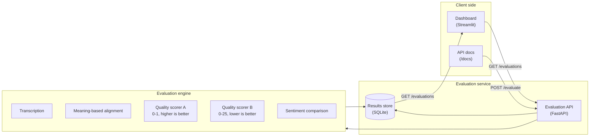

# `compnova-translationevals` — Architecture

This repository holds the CompNova evaluation engine for spoken translation
(S2ST) and the demo built on top of it: an **evaluation API** and a
**read-only dashboard** that lists and visualises the results.

> **Models are deliberately unnamed.** Nothing in this document, the API,
> the API responses or the dashboard names the models that do the work.
> The quality scores are exposed as *Model Alpha* and *Model Beta*, and
> the field names describe what a score measures, never what produced it.

## What the system does

1. A user supplies a **source clip** and the **translated clip** (an upload,
   or a pair of files sitting in a folder).
2. Both clips are transcribed into sentences.
3. The source and target sentences are **aligned by meaning**, so a
   translation that merges or splits sentences still lines up with the
   original.
4. Every aligned pair is scored by **two independent reference-free quality
   scorers**, and the **sentiment** of both sides is compared.
5. Segments that could not be aligned are returned separately, so omissions
   in a translation are visible instead of silently dropped.

Because both scorers are reference-free, **no reference translation is
required** — which is what makes the demo usable on a machine that has
never seen the corpus being evaluated.

## Component map

## The evaluation pipeline

| Stage | What happens | Notes |
| --- | --- | --- |
| Transcription | Both clips are turned into sentences | Sentence-level segments, silence trimmed |
| Alignment | Source and target sentences are paired by meaning | Monotonic dynamic programming over sentence embeddings; consecutive segments may be merged on either side to survive re-segmentation |
| Scoring | Each pair is scored by two scorers | A: 0–1, higher is better. B: 0–25, lower is better |
| Sentiment | Both sides of each pair are classified | Five sentiment classes, compared pairwise |
| Reporting | Per-pair detail, clip-level averages, unmatched segments | Stored so the dashboard can replay history |

Two details are worth calling out:

- **Alignment is semantic, not positional.** A translation that splits one
  source sentence into two, or merges two into one, still lines up with the
  original. Segments with no acceptable counterpart are returned as
  *unmatched* rather than force-paired to whatever happens to be next.
- **Low scores are flagged, not hidden.** A pair below the Model Alpha
  threshold (0.4) is highlighted in the dashboard so a reviewer goes
  straight to the sentences that need attention.

## The API

| Method | Path | Purpose |
| --- | --- | --- |
| `POST` | `/evaluate` | Evaluate a source/target audio pair |
| `POST` | `/transcribe` | Transcribe a single clip |
| `GET` | `/evaluations` | List stored evaluations (metadata only) |
| `GET` | `/evaluations/latest` | The most recent evaluation |
| `GET` | `/evaluations/{id}` | One full evaluation |
| `GET` | `/health` | Liveness check |

`/evaluate` accepts two audio uploads plus two optional query parameters:

- `min_similarity` — how similar a pair must be before it counts as aligned.
- `max_merge` — how many consecutive segments may be merged on each side
  when looking for a match.

The response carries the transcripts, a summary block, the per-pair detail
and the unmatched segments. The summary block uses the same neutral field
names as the per-pair detail (`semantic_quality`, `reference_free_quality`,
`sentiment_agreement_pct`).

The interactive documentation page (`/docs`) is generated from the same
service, so it never drifts from the implementation.

## Results store

Every evaluation is written to a small SQLite database (`evaluations.db` by
default, `EVAL_DB_PATH` to move it). The dashboard reads from it through the
API, so the dashboard itself holds no state and can be restarted at any
time without losing history.

Results recorded before the score fields were renamed are normalised when
they are read, so stored history renders with the same neutral labels as
new evaluations.

## The dashboard

A read-only view over the stored evaluations:

- clip-level summary tiles,
- a per-sentence-pair score chart — clicking a point opens that pair,
- a table of every sentence pair with the low-scoring ones highlighted,
- the two transcripts side by side,
- the unmatched segments in their own expander.

It loads no models and evaluates nothing itself: everything comes from the
API over HTTP.

## Design decisions

- **Reference-free scoring.** No reference translation is needed, so any
  system can be evaluated against any other without a parallel corpus.
- **Meaning-based alignment.** Position-based pairing systematically
  mislabels translations that re-segment, and that error then shows up in
  every downstream score.
- **Generic public field names.** The demo is meant to show what the engine
  measures, not which weights it uses. The public API, the API response and
  the dashboard all use neutral names; the implementation details stay on
  the server.
- **Results are stored, not recomputed.** Re-running an evaluation costs
  GPU time; keeping the results makes the dashboard instant and the history
  comparable.

## Limits

- **No authentication.** Anyone with the URLs can run evaluations and read
  stored results. Share the links only with people who need them.
- **One evaluation at a time.** The quality scorers write to fixed
  scratch files, so concurrent requests can overwrite each other.
- **Proxy timeouts.** A gateway timeout does not mean the evaluation
  failed — check the dashboard or the service log before retrying, or the
  same clip can be evaluated twice.
