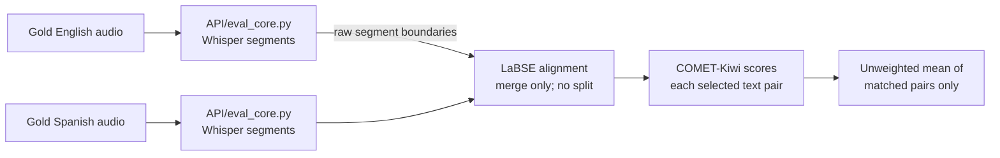

# COMET score on the gold English–Spanish audio pair

## Scope and conclusion

The files [`DRAL_EN_2min.wav`](codebase_eval_pulkit/DRAL_EN_2min.wav) and [`DRAL_ES_2min.wav`](codebase_eval_pulkit/DRAL_ES_2min.wav) are the **gold-standard source and Spanish translation** for this evaluation. The low reported COMET-Kiwi score does not, by itself, establish that the Spanish audio is inaccurate. The preprocessing can send COMET English and Spanish chunks that contain different parts of the conversation.

**RunPod entry point checked:** [`API/runpod_start.sh`](API/runpod_start.sh#L33) changes its working directory to `API/` ([line 74](API/runpod_start.sh#L74)), then starts `uvicorn api:app` ([line 327](API/runpod_start.sh#L327)). That resolves to [`API/api.py`](API/api.py#L16), which calls [`API/eval_core.py`](API/eval_core.py#L237). **The API references below are the RunPod evaluation path.** On the newer remote branch, `API/DemoApp.py` is a read-only monitor that calls the API; it does not calculate COMET itself.

**Version boundary:** this local checkout is at `6ff006c`, while `origin/SahilPatil266-API` is at `e6f64ab`. The local gold pair linked above is under `codebase_eval_pulkit/`; the newer branch instead contains root-level `EN_147l.wav` and `ES_147l.wav` (124.412 s and 132.901 s). The algorithm in `API/eval_core.py` is the same in both revisions, but the audio pairs and dashboard files must not be conflated.

The verified defect is a **boundary mismatch before scoring**: Whisper segments are treated as sentences, although they can start or end mid-thought. The aligner can concatenate up to two segments per side but cannot split a segment at the translation boundary. Its scoring objective also rewards producing more pairs, even when a larger merged pair is a better semantic match.

## Evidence in the current pipeline

1. The active [`API/eval_core.py` transcription](API/eval_core.py#L95) returns `seg.text` directly from Faster-Whisper and discards segment timestamps. It performs no sentence or clause segmentation.
2. The active [API aligner](API/eval_core.py#L124) allows only whole-segment matches and **merges** (`max_merge=2` by default). It cannot divide a segment whose first half belongs to one translation chunk and second half to the next.
3. The aligner maximizes the **sum** of pair similarities ([line 163](API/eval_core.py#L163)). In an isolated execution of this function, two 0.60 matches beat one 0.95 merged match because `0.60 + 0.60 > 0.95`. The objective therefore favors fragmentation independently of translation quality.
4. The API's [headline COMET number](API/eval_core.py#L278) is the arithmetic mean over **matched pairs only**. Skipped material is returned separately but contributes nothing to that number. Chunk size and alignment choices can therefore change the headline score for the same audio.
5. The API accepts request-time `min_similarity` and `max_merge` settings ([parameters](API/api.py#L55)), but does not include them in the [result](API/eval_core.py#L284). It also calculates each pair's `similarity` ([alignment](API/eval_core.py#L181)) and omits it from the [chunk payload](API/eval_core.py#L268). This prevents a stored score from fully explaining its alignment choices. The newer branch stores evaluation results in SQLite, but its result payload still omits these settings and similarities.

The repository's [saved chunk input](metricx/results/metricx_chunk_input.jsonl) illustrates the boundary problem: pair 1 ends on the English side with “so what time is,” but the Spanish question begins in pair 2; pair 3 begins with English “the empire,” whose Spanish counterpart is in pair 2. **This is a root-level `DemoApp.py`/MetricX artifact**, identified by its `metricx_chunk_input.jsonl` filename ([writer](DemoApp.py#L485)). RunPod's API writes `metricx_api_input.jsonl` under `API/metricx/results/` ([writer](API/eval_core.py#L209)); the script links `API/metricx` to `/opt/metricx` ([link setup](API/runpod_start.sh#L241)). The saved artifact has no audio filenames or run ID; it is corroborating evidence of the same algorithm's failure mode, not a trace from the active RunPod API or proof that these rows came from the named WAVs. The exact contribution of misalignment to the reported score requires an API rerun with a per-pair trace.

## What “65% accuracy” means here

The configured model is **reference-free COMET-Kiwi**: it receives `src` and `mt`, with no gold reference ([API call](API/eval_core.py#L193)). Its output is a learned translation-quality score on a roughly 0–1 scale, **not a percentage of correct words or a calibrated accuracy rate**. Gold-standard translations can score below 1.0 even with correct alignment. See [COMET's scoring guidance](https://github.com/Unbabel/COMET#interpreting-scores). The preprocessing defect makes this particular score less trustworthy; it does not establish what the corrected score will be.

## Production fix

1. Keep word timestamps and explicit language settings during ASR. Build sentence or clause units using punctuation, pauses, and token-length bounds. Preserve each unit's source audio interval and transcription confidence. Prefer dataset-provided aligned fragment boundaries when available.
2. Replace the merge-only aligner with monotonic many-to-many alignment that can **split and merge** units. Optimize a length-normalized match score with explicit gap penalties; use timestamps as a soft constraint because re-enacted translations can differ in duration. Require review or return an indeterminate result when alignment confidence or source/target coverage is low.
3. Score only validated, meaning-equivalent spans. Report per-span text, time range, similarity, COMET score, unmatched coverage, and the alignment parameters used. Aggregate by source duration or token coverage rather than a plain mean over arbitrary chunks; show coverage beside the score.
4. Implement and validate the fix in `API/eval_core.py`, the active RunPod scoring path. The newer branch's `API/DemoApp.py` already reads from the API. Test reviewed gold pairs, boundary-crossing segments, one-to-many matches, omissions, and unrelated audio; compare scores before and after on a fixed corpus.

## RunPod version and restart note

This local checkout has no `API/DemoApp.py`, so its untracked copy of [`runpod_start.sh`](API/runpod_start.sh#L350) cannot launch a dashboard *from these local files*. The newer remote branch `e6f64ab` does contain `API/DemoApp.py`, so the other review is correct that the dashboard path works **on that branch**. The script does not pull repository changes and leaves a healthy API process running in normal start mode ([check](API/runpod_start.sh#L322)); update the pod checkout and use `--restart` to load edited code. Neither checkout alone establishes which commit is currently running on the pod.

If the product goal is to compare **generated Spanish audio against this gold Spanish audio**, transcribe the gold Spanish audio separately and add a reference-based metric using `source`, `candidate`, and `gold reference`. Keep the reference-free score as a separate diagnostic.
