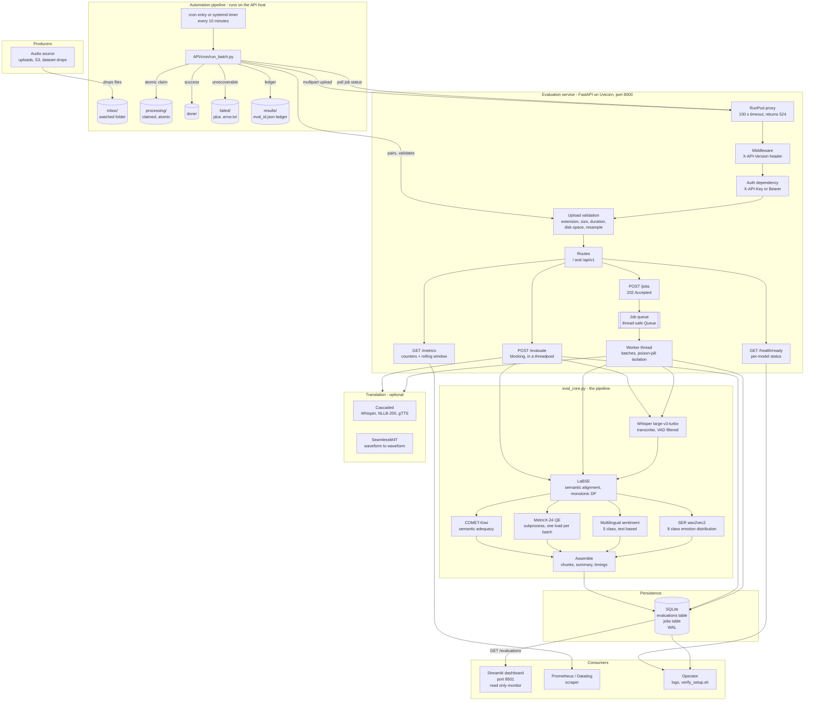
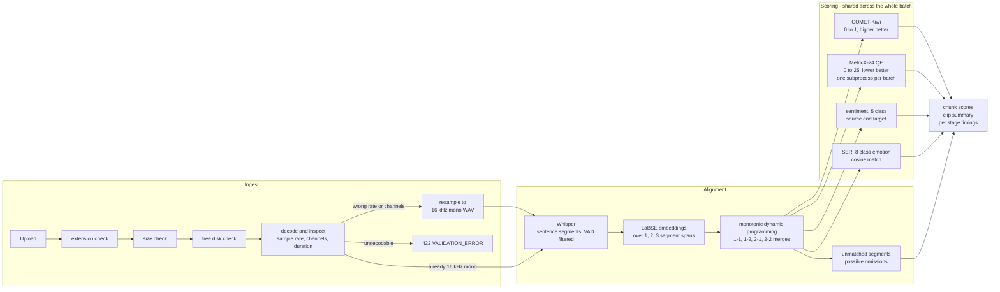
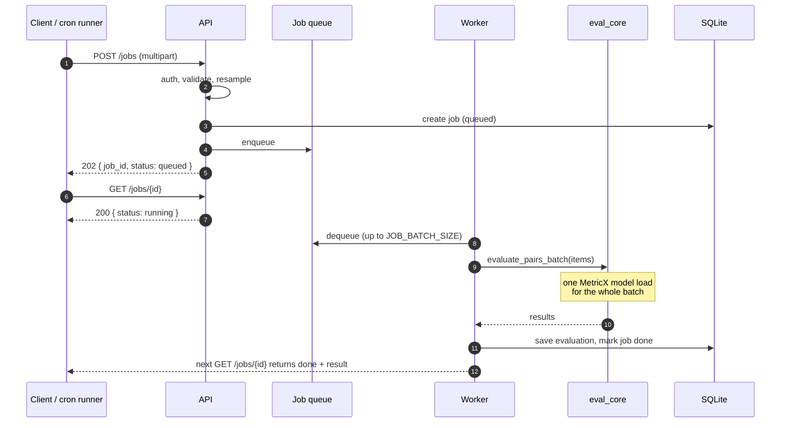
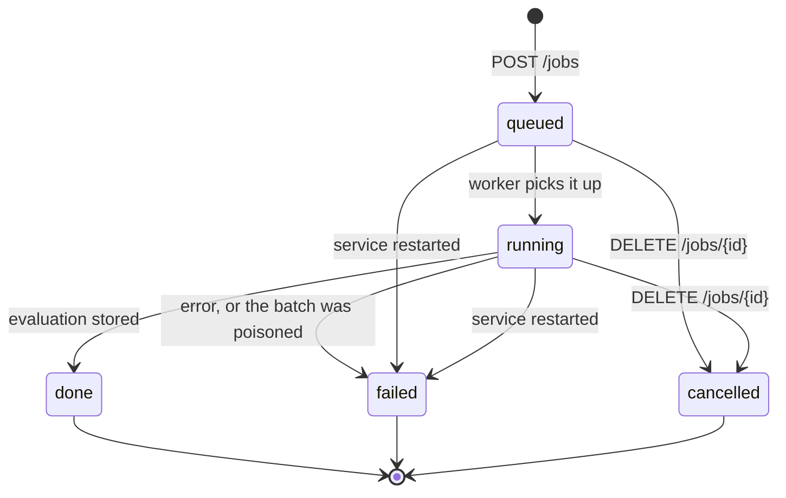
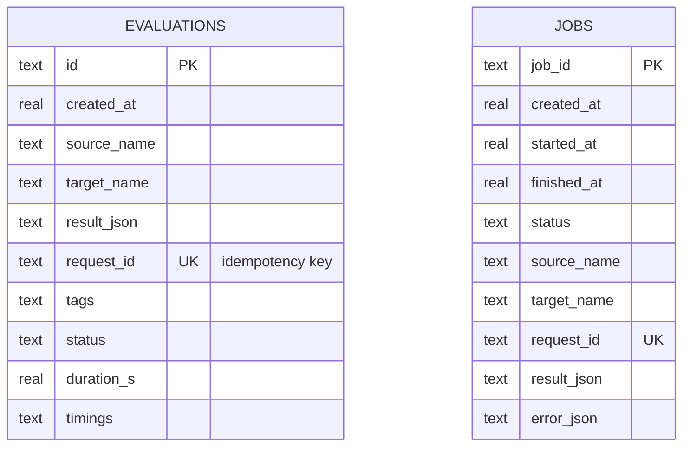
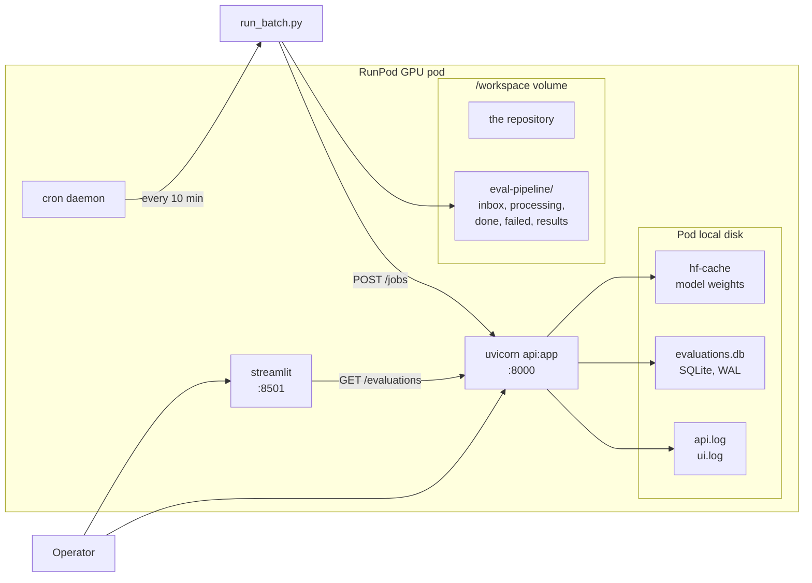

# CompNova Evaluation API - Architecture

> [!abstract] What this is
> The CompNova evaluation service exposes a **speech-to-speech translation (S2ST)
> evaluation engine** over HTTP, plus a **cron-driven automation pipeline** that
> turns a watched folder of audio into scored results with no human in the loop.
>
> This note is the architecture reference for version **2.1.0**.
> For the per-model detail — what each checkpoint does, how big it is and where it
> is used — see [[CompNova Model Reference]].

---

## 1. What the system does

The API takes a **pair** of audio files (source speech and its translation), aligns
them by meaning, scores every aligned chunk with reference-free quality metrics, and
stores the result. It can also **translate** first, when it is given only source
audio.

| | |
|---|---|
| **Input** | `source_audio` + `target_audio` — or just `source_audio` plus a target language |
| **Output** | per-chunk scores, transcripts, sentiment agreement, a SER emotion match, per-stage timings |
| **Storage** | every evaluation lands in SQLite on the API host and gets a stable `id` |
| **Transport** | FastAPI over HTTP, mounted at both `/` and `/api/v1` |

> [!info] Reference-free by design
> No human reference transcript is needed. That is what makes unattended batch
> scoring possible — at the cost of the metrics being *proxies* rather than ground
> truth. Sample and human-audit a subset before making a final quality claim.

---

## 2. What changed in 2.1

| Change | Where it lands |
|---|---|
| **Speech Emotion Recognition** joins the pipeline: `ser_match_score` plus top-1 emotion labels | `POST /evaluate`, `POST /jobs` |
| **Audio validated on ingest** — corrupt files rejected with `422`, non-16 kHz / multi-channel audio resampled to 16 kHz mono | every upload |
| **Every route also served at `/api/v1/…`**, plus an `X-API-Version` response header | all routes |
| **`Authorization: Bearer`** accepted alongside `X-API-Key` | all routes except the probes |
| **Poison-pill isolation** — a failing batch is retried one job at a time | job worker |
| **Rolling quality window** — mean scores and latency percentiles | `GET /metrics` |
| **Prometheus output** | `GET /metrics?format=prometheus`, `GET /metrics/prometheus` |
| **Automatic retention sweep** | background worker |
| **Crash recovery** — jobs left `queued`/`running` by a dead process are failed with `SERVICE_RESTARTED` | startup |
| **Job `state` aliases** — `queued`/`running`/`done` also exposed as `pending`/`processing`/`completed` | `GET /jobs` |
| **`INSUFFICIENT_DISK`** — a full spool is no longer reported as `GPU_OUT_OF_MEMORY` | error model |

> [!warning] The SER checkpoint is English-only
> `ehcalabres/wav2vec2-lg-xlsr-en-speech-emotion-recognition` reports roughly **0.93**
> same-language accuracy and roughly **0.46 cross-lingual** — which is exactly why the
> Streamlit playground shipped with SER switched off. For a cross-lingual pair
> (EN → ES) the **target**-side emotion is out of distribution, so `ser_match_score`
> is **not** a translation-quality signal.
>
> It is on by default (`EVAL_SER_ENABLED=1`), the service logs a warning at startup,
> and `/health/ready` reports `ser_model_language` so a client can tell.

---

## 3. System architecture



> [!tip] Reading the diagram
> The **only** stateful component is the SQLite store. The job queue is in-process
> and in memory, which is why in-flight jobs are failed on startup — there is no
> queue to recover from.

---

## 4. The evaluation pipeline



> [!note] Alignment is by meaning, not by position
> Source and target segments are embedded with LaBSE and matched with a monotonic
> dynamic program, so a sentence that was split differently on the two sides still
> lines up. Segments that find no acceptable match are reported in `unmatched`
> rather than force-paired — a non-zero count is a red flag for **omission**.

---

## 5. Job lifecycle





| Internal `status` | Spec alias `state` | Meaning |
|---|---|---|
| `queued` | `pending` | Accepted, waiting for the worker |
| `running` | `processing` | Being evaluated |
| `done` | `completed` | Finished; `result` carries the evaluation |
| `failed` | `failed` | `error` carries the structured error |
| `cancelled` | `cancelled` | Cancelled before completion |

> [!danger] One bad file cannot fail a batch
> If a multi-job batch raises, the worker **retries each job individually**. The
> poison-pill job fails with its own error code; its healthy neighbours still
> succeed. The cost is that a failing batch pays one MetricX model load per job.

---

## 6. Storage



* SQLite in **WAL** mode, so a long `/evaluations` listing never blocks the writer.
* `request_id` carries a **unique index** — that is what makes `X-Request-Id`
  idempotent.
* `delete_before()` is the retention sweep: it removes expired evaluations **and**
  finished jobs.

---

## 7. Endpoint reference

Every route is served at **both** `/<path>` and `/api/v1/<path>`.

| Method | Path | Auth | Purpose |
|---|---|---|---|
| `GET` | `/health` | no | Liveness |
| `GET` | `/health/ready` | no | Readiness plus the per-model report |
| `GET` | `/metrics` | no | Counters and the rolling quality window |
| `GET` | `/metrics/prometheus` | no | The same counters in Prometheus text format |
| `POST` | `/transcribe` | yes | Transcript only |
| `POST` | `/translate` | yes | Translate audio |
| `POST` | `/evaluate` | yes | Evaluate, blocking |
| `POST` | `/jobs` | yes | Evaluate, queued — `202` |
| `GET` | `/jobs` · `/jobs/{id}` | yes | Job status |
| `DELETE` | `/jobs/{id}` | yes | Cancel a job |
| `GET` | `/evaluations` · `/evaluations/latest` · `/evaluations/{id}` | yes | Read results |
| `GET` | `/evaluations/export` | yes | CSV or JSONL export |
| `DELETE` | `/evaluations/{id}` | yes | Delete one |
| `POST` | `/evaluations/prune` | yes | Retention sweep |

---

## 8. Error model

Every failure has the same shape, so a client can branch on `code` and on
`retryable` instead of string-matching a message.

```json
{
  "error": {
    "code": "GPU_OUT_OF_MEMORY",
    "message": "CUDA out of memory. Tried to allocate 2.00 GiB",
    "retryable": true
  }
}
```

| Code | Status | Retryable | Cause |
|---|---|---|---|
| `VALIDATION_ERROR` | 422 | no | Bad parameters, corrupt audio, clip too long |
| `UNAUTHORIZED` | 401 | no | Missing or wrong API key |
| `UNSUPPORTED_AUDIO` | 415 | no | Wrong file extension |
| `PAYLOAD_TOO_LARGE` | 413 | no | Above `EVAL_MAX_UPLOAD_MB` |
| `INSUFFICIENT_DISK` | 507 | **no** | The spool or the database volume is full |
| `MODEL_UNAVAILABLE` | 503 | yes | Models still loading, or one failed |
| `GPU_OUT_OF_MEMORY` | 503 | yes | The GPU ran out of memory |
| `BUSY` | 503 | yes | Transient failure |
| `TIMEOUT` | 504 | yes | The evaluation took too long |
| `INTERNAL_ERROR` | 500 | no | Anything else |

---

## 9. Configuration

| Variable | Default | Meaning |
|---|---|---|
| `HF_TOKEN` | — | Needed for the gated COMET-Kiwi model |
| `EVAL_API_KEYS` | *(empty)* | Comma-separated keys. **Empty means the service is open.** |
| `EVAL_DB_PATH` | `/var/lib/compnova/evaluations.db` | Absolute path, on a persistent volume |
| `EVAL_SPOOL_DIR` | `/var/lib/compnova/spool` | Where uploads are staged |
| `EVAL_JOB_WORKERS` | `1` | How many evaluations may run at once |
| `EVAL_JOB_BATCH_SIZE` | `8` | How many queued jobs share one MetricX load |
| `EVAL_MAX_UPLOAD_MB` | `200` | Largest accepted upload |
| `EVAL_MAX_AUDIO_SECONDS` | `1800` | Longest accepted clip |
| `EVAL_AUTO_RESAMPLE_16K` | `1` | Resample instead of rejecting |
| `EVAL_EXPECTED_SAMPLE_RATE` | `16000` | Expected sample rate |
| `EVAL_EXPECTED_CHANNELS` | `1` | Expected channel count |
| `EVAL_MIN_FREE_DISK_MB` | `2048` | Refuse uploads below this |
| `EVAL_SER_ENABLED` | `1` | Speech Emotion Recognition. **English-only checkpoint.** |
| `EVAL_SER_MODEL_LANGUAGE` | `en` | Reported by `/health/ready` |
| `EVAL_TRANSLATE_ENABLED` | `1` | The translation models |
| `EVAL_RETENTION_DAYS` | `0` | `0` keeps everything forever |
| `EVAL_METRICS_HISTORY` | `500` | Size of the rolling quality window |
| `EVAL_LOG_FORMAT` | `text` | `json` for one structured line per evaluation |
| `EVAL_CORS_ORIGINS` | *(empty)* | Extra browser origins |
| `EVAL_API_URL` | `http://localhost:8000` | Read by the dashboard and the runner |
| `EVAL_API_KEY` | *(empty)* | Read by the dashboard and the runner |

---

## 10. Deployment



> [!warning] Results live on the pod's own disk by default
> `/var/lib/compnova` is the pod's local disk — fast and consistent, but gone when
> the pod is recreated. Point `EVAL_DB_PATH` at a `/workspace` path to keep them
> across recreations, and export them regularly with `GET /evaluations/export`.

---

## 11. Testing

| Suite | What it proves | Needs a GPU? |
|---|---|---|
| `API/test_api.py` | 106 checks over the whole HTTP surface — routing, auth, validation, jobs, the store, telemetry, errors | no |
| `API/test_server.py` | 19 checks — boots a **real Uvicorn server** and drives it over a socket | no |
| `API/cron/test_runner.py` | 25 checks — the whole pipeline against a mock API: pairing, dead-lettering, auth, stale recovery | no |
| `API/verify_setup.sh` | The real thing, on the pod, with the real models | **yes** |

All three offline suites stub `torch` and every model loader through
`API/testkit.py`, so **nothing is downloaded** and no GPU is needed.

```bash
pip install fastapi httpx numpy python-multipart
python3 API/test_api.py
python3 API/test_server.py
python3 API/cron/test_runner.py
```

---

## 12. Known caveats

> [!warning] MetricX reloads its model on every batch
> `metricx24.predict` is upstream research code with no library entry point, so it
> runs as a subprocess that loads its model every time. Batching keeps this to one
> load per batch rather than one per file, but a batch of one still pays it.
> Keeping MetricX resident is the remaining fix — see `API/ROADMAP.md`.

> [!warning] Per-job timings are batch timings
> `timings` and `duration_s` are measured for the whole batch and shared by every
> job in it. Fine for throughput planning, misleading if you try to attribute a
> slow job.

> [!info] The rolling quality window is in memory
> `/metrics` keeps the last `EVAL_METRICS_HISTORY` evaluations in a process-local
> deque. It resets on restart and is not shared between workers.

> [!tip] The API must not be exposed without a key
> `EVAL_API_KEYS` is empty by default so a fresh pod works out of the box. Anyone
> with the URL can spend GPU time and read every transcript. Set it before sharing
> the URL.

---

## 13. Related notes

- [[CompNova Model Reference]] — every checkpoint, what it does, how big it is
- `API/API_GUIDE.md` — the full programmatic contract
- `API/ROADMAP.md` — what is done and what is still open
- `API/RUNPOD_SETUP.md` — bringing the service up on a pod
- `API/cron/README.md` — the batch runner in detail

[^1]: The RunPod proxy times out at roughly 100 seconds and returns `524` while the
evaluation keeps running on the server. The job API exists so a client never has to
block on that.
