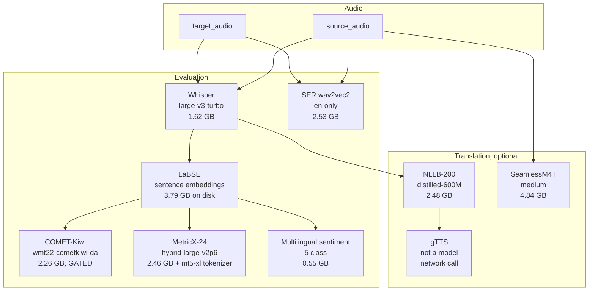
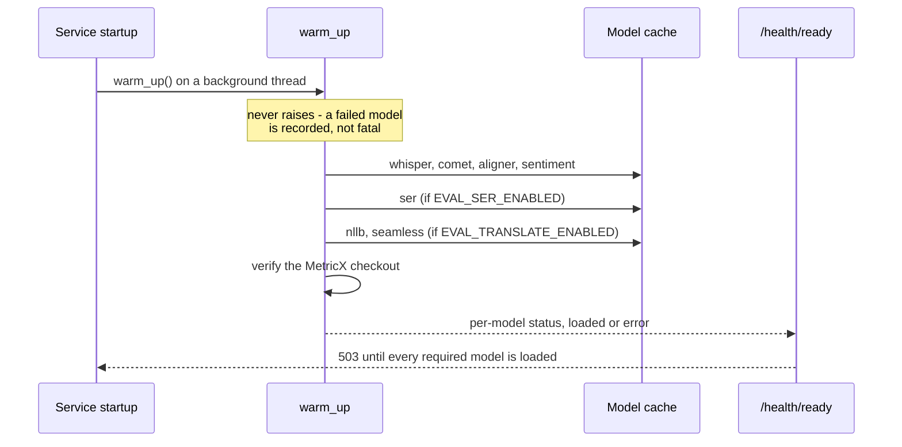

# CompNova Model Reference

> [!abstract] Every checkpoint in the CompNova evaluation stack
> What each model does, where it is used, how big it is, and the caveat you need
> to know before you trust its output. For how the models fit together, see
> [[CompNova Evaluation API - Architecture]].

---

## 1. The stack at a glance



---

## 2. Master table

| Model | Hub id | Role | Disk | Gated | VRAM (approx) |
|---|---|---|---|---|---|
| Whisper large-v3-turbo | `mobiuslabsgmbh/faster-whisper-large-v3-turbo` | Transcription of both sides | 1.62 GB | no | ~1.6 GB |
| COMET-Kiwi | `Unbabel/wmt22-cometkiwi-da` | Semantic adequacy and fluency | 2.26 GB | **yes** | ~2.3 GB |
| MetricX-24 QE | `google/metricx-24-hybrid-large-v2p6-bfloat16` | Error-density proxy | 2.46 GB | no | ~5.7 GB |
| mt5-xl tokenizer | `google/mt5-xl` | Tokenizer for MetricX only | ~5 MB | no | — |
| LaBSE | `sentence-transformers/LaBSE` | Semantic alignment | 3.79 GB | no | ~1.9 GB |
| Multilingual sentiment | `tabularisai/multilingual-sentiment-analysis` | 5-class text sentiment | 0.55 GB | no | ~0.6 GB |
| SER wav2vec2 | `ehcalabres/wav2vec2-lg-xlsr-en-speech-emotion-recognition` | 8-class emotion | 2.53 GB | no | ~1.3 GB |
| NLLB-200 distilled 600M | `facebook/nllb-200-distilled-600M` | Cascaded text translation | 2.48 GB | no | ~2.5 GB |
| SeamlessM4T medium | `facebook/hf-seamless-m4t-medium` | Direct waveform-to-waveform translation | 4.84 GB | no | ~4.8 GB |
| gTTS | — | Speech synthesis (network call) | 0 | n/a | — |

> [!note] "Disk" is what the setup script actually downloads
> Some repos ship the same weights in two formats (`.bin` **and** `.safetensors`),
> so the figure can be roughly double the model itself. LaBSE and the SER
> checkpoint are both in that position.

---

## 3. Evaluation models

### 3.1 Whisper large-v3-turbo

`mobiuslabsgmbh/faster-whisper-large-v3-turbo`

The CTranslate2 conversion of OpenAI's `whisper-large-v3-turbo`, used through
`faster-whisper`.

| | |
|---|---|
| **Used for** | Transcribing the source and the target; producing the sentence segments that everything else operates on |
| **Configuration** | `beam_size=5`, VAD filtering with `min_silence_duration_ms=500` |
| **Precision** | `float16` on CUDA, `int8` on CPU |
| **Residency** | `lru_cache`d — loaded once, stays in VRAM |

> [!tip] Why VAD filtering matters
> The VAD pass strips silence before decoding, which is what makes the
> sentence-level segmentation usable for alignment. Without it, long pauses become
> their own "sentences" and the alignment degrades.

### 3.2 COMET-Kiwi

`Unbabel/wmt22-cometkiwi-da` — **gated**.

The semantic-quality scorer. It is *reference-free*: it compares the source and the
hypothesis directly, so no human reference transcript is needed. That is the single
property that makes unattended batch scoring possible.

| | |
|---|---|
| **Used for** | `comet_kiwi` — the headline quality number |
| **Range** | 0 to 1, **higher is better** |
| **Batch size** | 8 inside `predict()` |
| **Residency** | `lru_cache`d |

> [!warning] Gated — the token's account must accept the terms
> The setup script fails with *"access denied"* when the Hugging Face account that
> owns `HF_TOKEN` has not accepted the licence for this model. Accept it at
> `huggingface.co/Unbabel/wmt22-cometkiwi-da` before the first pod start.

### 3.3 MetricX-24 QE

`google/metricx-24-hybrid-large-v2p6-bfloat16`, tokenized with `google/mt5-xl`.

The error-density scorer, also reference-free. The QE variant conditions on the
source and the hypothesis only, with no reference.

| | |
|---|---|
| **Used for** | `metricx_24` — the second quality number |
| **Range** | 0 to 25, **lower is better** |
| **Normalisation** | The dashboard plots `1 - score/25` so it shares COMET's 0–1 axis |
| **Code** | Cloned from `google-research/metricx`, pinned at `fc4978eb064670f7cc33e93ea4f52d38396b8ae6` |

> [!warning] This is the one model that is not resident
> `metricx24.predict` is research code with no library entry point, so the service
> runs it as a **subprocess that loads its model on every call**. Two consequences:
>
> 1. **Throughput** — roughly 30 to 60 seconds of pure model loading per batch.
>    Batching several jobs into one call is what keeps a folder of files affordable.
> 2. **Correctness** — the call is serialised by a lock and uses request-unique file
>    names, so two concurrent evaluations can never overwrite each other's scores.
>
> Keeping it resident is the remaining performance work — see `API/ROADMAP.md`.

### 3.4 LaBSE

`sentence-transformers/LaBSE`

The alignment model. It embeds every 1, 2 and 3-segment span of both transcripts and
a monotonic dynamic program picks the best non-crossing alignment.

| | |
|---|---|
| **Used for** | Aligning source segments to target segments **by meaning, not by position** |
| **Coverage** | 109 languages |
| **Similarity** | Cosine, thresholded by `min_similarity` (default 0.5) |

> [!tip] The dial that matters most
> `min_similarity` is the recall/precision knob. Too high and real content shows up
> in `unmatched` (false omissions). Too low and the aligner pairs unrelated
> sentences (false matches, inflated scores). `max_merge` controls how many
> consecutive segments may be joined on each side — `2` allows 1-1, 1-2, 2-1 and
> 2-2 alignments.

### 3.5 Multilingual sentiment

`tabularisai/multilingual-sentiment-analysis`

The text-based sentiment classifier, applied to both sides of every aligned chunk.

| | |
|---|---|
| **Used for** | `sentiment_agreement_pct` — the share of chunks where both sides carry the same label |
| **Labels** | `"1 star"` … `"5 stars"` |
| **Range** | 0 to 100 %, higher is better |

> [!caution] Label naming
> The labels are star ratings, not the *"Very Negative … Very Positive"* wording
> that appears in older notes and in the app's own description. The loaded model
> produces star ratings — trust the field values, not the prose.

### 3.6 SER — wav2vec2 speech emotion

`ehcalabres/wav2vec2-lg-xlsr-en-speech-emotion-recognition`

The audio emotion classifier. It reads tone directly off the waveform, so it is
independent of transcription accuracy and of the target language's tokenizer
coverage — which is precisely why it is interesting.

| | |
|---|---|
| **Used for** | `ser_match_score` — cosine similarity between the source and target 8-class distributions |
| **Labels** | `angry`, `calm`, `disgust`, `fearful`, `happy`, `neutral`, `sad`, `surprised` |
| **Input** | 16 kHz mono waveform |
| **Output** | A probability distribution per side, plus the cosine match (0 to 1, higher is better) |

> [!warning] The checkpoint is English-only, and the head has to be rebuilt by hand
> **Accuracy.** Published benchmarks put same-language accuracy around **0.93** and
> cross-lingual around **0.46**. The Streamlit playground shipped with SER switched
> off for exactly this reason. On a cross-lingual pair the **target**-side emotion is
> out of distribution, so `ser_match_score` is not a translation-quality signal —
> it is a property of the source audio. Set `EVAL_SER_ENABLED=0` to turn it off.
>
> **The head.** The checkpoint predates modern `transformers`, which would silently
> re-initialise its two-layer classifier with random weights and produce
> near-uniform output. The loader rebuilds the head — `Linear → Tanh → Dropout →
> Linear` — and patches the trained weights in from the safetensors file. The
> `model.safetensors` file is required; the repo also ships a `.bin`, but the
> safetensors path is what the loader reads.

---

## 4. Translation models

Both are optional and are loaded **on demand** — a deployment that only evaluates
never pays for them.

### 4.1 NLLB-200 distilled 600M

`facebook/nllb-200-distilled-600M`

Text-to-text translation, 200 languages. Used by the **cascaded** path:

```
audio → Whisper → NLLB-200 → gTTS → translated audio
```

The distilled 600M variant is used rather than the full model specifically to avoid
out-of-memory crashes on smaller cloud tiers.

### 4.2 SeamlessM4T medium

`facebook/hf-seamless-m4t-medium`

The **direct** path — waveform in, translated waveform out, in one shot. It uses
SeamlessM4T's own three-letter target language codes.

### 4.3 gTTS

Not a model: it calls Google's Translate text-to-speech endpoint over the network.

> [!caution] gTTS needs outbound internet
> On a RunPod pod that works. On an air-gapped host use `mode=seamless`, which is
> entirely local. The cascaded path also produces an `.mp3`, which the service
> converts to 16 kHz mono WAV with ffmpeg.

---

## 5. Disk and VRAM budget

| Configuration | Disk for models | Approx. VRAM per evaluation |
|---|---|---|
| Evaluation only | ~10.7 GB | ~13.5 GB |
| Evaluation + SER | ~13.2 GB | ~15 GB |
| Evaluation + SER + translation | ~20.5 GB | ~21 GB |

The setup script checks for enough disk before it starts, and now sizes that check
against what it is actually going to download:

| Switch | Additional disk |
|---|---|
| Base (evaluation) | 11 GB |
| `EVAL_SER_ENABLED=1` | +3 GB |
| `EVAL_TRANSLATE_ENABLED=1` | +8 GB |
| Headroom | +2 GB |

**Concurrency.** `EVAL_JOB_WORKERS=1` is the safe default. On a **48 GB** pod,
`EVAL_JOB_WORKERS=2` fits comfortably (roughly 30 GB of weights resident at once); on
a **32 GB** pod it is tight. The models are large and the pipeline is GPU-bound —
throughput is "one evaluation at a time" unless you deliberately buy more VRAM.

---

## 6. How the models are loaded



* Every model loader is `functools.lru_cache`d, so a model is loaded **once** and
  stays resident.
* The warm-up runs on a background thread, so `/health` answers immediately while
  ten gigabytes of weights are still downloading.
* A model that fails to load is **recorded, not fatal** — it shows up in the
  `/health/ready` report and surfaces as a clean `MODEL_UNAVAILABLE` on the first
  request that needs it. The service never crash-loops on a flaky download.

---

## 7. Where each model is used

| Stage | Models |
|---|---|
| Ingest and validation | *(none — `soundfile`, `wave`, `ffprobe`)* |
| Transcription | Whisper |
| Alignment | LaBSE |
| Quality scoring | COMET-Kiwi, MetricX-24 |
| Sentiment | Multilingual sentiment |
| Emotion | SER wav2vec2 |
| Translation | NLLB-200 + gTTS, or SeamlessM4T |
| Tokenizer only | mt5-xl (for MetricX) |

---

## 8. Licences and access

| Model | Access |
|---|---|
| COMET-Kiwi | **Gated** — accept the licence with the account that owns `HF_TOKEN` |
| Whisper, LaBSE, sentiment, SER, NLLB, SeamlessM4T, MetricX-24, mt5-xl | Open |
| MetricX-24 *code* | Apache-2.0, from `google-research/metricx`, pinned to a commit |

---

## 9. Related notes

- [[CompNova Evaluation API - Architecture]] — how the models fit into the service
- `API/API_GUIDE.md` — the programmatic contract
- `API/ROADMAP.md` — what is done and what is still open
